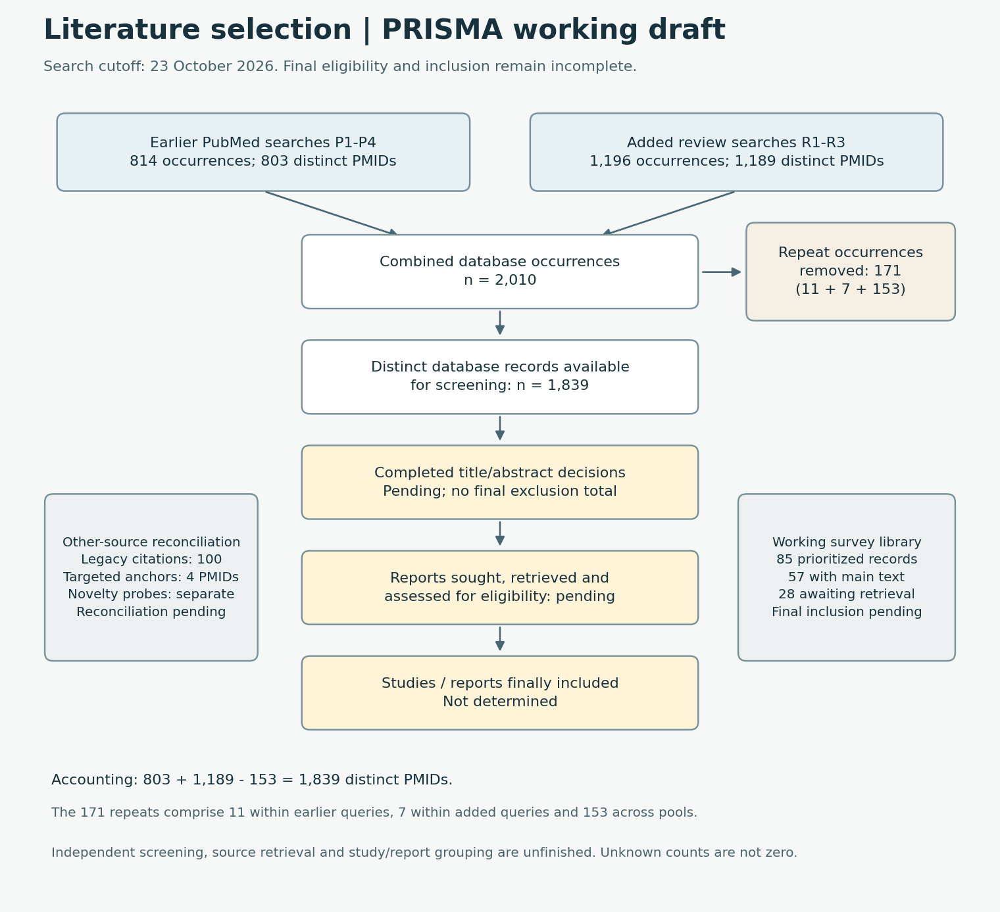

# PRISMA analysis and diagram

Updated 23 October 2026 for the professor's 24 October tasks. This is an **auditable working selection record**, not a completed PRISMA report. Known search counts are reconciled; unknown screening, retrieval and final inclusion counts remain explicit.

[Vector figure](prisma.svg) | [PNG figure](prisma.png) | [Machine-readable counts](../data/reviews/prisma_counts.json)

## Executed searches and deduplication

| Source group | Search occurrences | Distinct PMIDs | Within-group repeated occurrences |
|---|---:|---:|---:|
| Earlier PubMed queries P1-P4 | 814 | 803 | 11 |
| Added review queries R1-R3 | 1,196 | 1,189 | 7 |
| Both groups together | 2,010 | 1,839 | 171 across all queries |

The two distinct-ID pools overlap by **153 PMIDs**. Therefore `803 + 1189 - 153 = 1839`, and `2010 - 1839 = 171`. The 171 repeat occurrences comprise the 11 earlier repeats, seven added repeats and 153 cross-pool repeats. No duplicate percentage is inferred for the entire field or for the original historical search.

Dates and exact queries are retained in [review_search_log.csv](../data/reviews/review_search_log.csv) and [the earlier PubMed search log](../data/audit/pubmed_search_log.csv). New queries broaden the domain block with MeSH terms and include orthopedic treatment/planning/outcome reviews, causal-method reviews and orthopedic agent reviews. All returned IDs were exported; none of the three new searches exceeded the export limit. The 1,839 distinct records form a mixed evidence-search pool, including primary studies from the earlier targeted query; they are not 1,839 review papers.

## What has and has not been screened

[review_triage.csv](../data/reviews/review_triage.csv) supplies rules-assisted navigation for 1,843 metadata records: the 1,839 search-derived PMIDs plus four separately obtained anchor PMIDs. Its labels are **not final eligibility decisions**. Current navigation counts are:

| Navigation label | Records | Interpretation |
|---|---:|---|
| Retained in working library from this metadata pool | 75 | Prioritized records; not final systematic inclusions |
| Manual scope check required | 1,224 | Potentially relevant; eligibility unfinished |
| Outside orthopedic scope candidate | 488 | Automated domain signal; needs judgment before exclusion |
| Nonreview candidate | 33 | Check primary-study versus review status |
| Adjacent diagnostic candidate | 18 | Check whether there is a treatment-decision link |
| Set aside after a retraction metadata flag | 5 | Retained in logs; not placed in the working library |

The counts sum to 1,843. Metadata retraction flags may include linked notices or corrected publication histories; inspect the source record before describing any specific paper as retracted. One explicit title is *RETRACTED: Artificial Intelligence in Osteoarthritis Diagnosis and Treatment: Advancements, Challenges, and Future Prospects* (PMID 41628715). No retracted candidate was included in the working survey library.

The working library contains **85 records**, because it additionally retains ten review/context citations from the legacy corpus outside this combined query pool, some without PMIDs. It contains 79 orthopedic records and six cross-domain context records. Those evidence streams must not share an orthopedic-study denominator.

There are original main-text sources for **57 library records**, with 28 records still requiring retrieval. File formats overlap: 22 PDF copies and 49 DOI-verified XML copies are available. Six additional original PDFs were recovered through publisher links with matching DOIs; see `Surveys/publisher_retrieval_log.csv`. These are source-access counts, not reports assessed for eligibility. Eleven close review frameworks have focused assistant dimension checks; no independent second-reviewer assessment or complete risk-of-bias appraisal is claimed.

## The professor's four phases

| Phase | Current state | Record needed to close it |
|---|---|---|
| Identification | Seven executed PubMed queries across both passes; supplementary discovery and legacy sources separate | Add actual searches from other databases and citation chains, with exports |
| Screening | Deduplicated candidate pool and rules-assisted navigation available | Completed title/abstract decisions, reviewer identity, reason codes and uncertainty resolution |
| Eligibility | Source collection and retrieval queue available; incomplete | Report-level retrieval outcomes, source identity, full-text decisions and one main exclusion reason |
| Inclusion | Not determined | Adjudicated included reports, study-family grouping and synthesis denominators |

[PRISMA 2020](https://www.prisma-statement.org/prisma-2020-flow-diagram) distinguishes records, reports and studies; its flow templates place retrieval and eligibility within the screening area. The four-phase presentation here retains the professor's terminology while preserving that detailed accounting. The broad evidence-mapping question may fit [PRISMA-ScR](https://www.prisma-statement.org/scoping); a final systematic-review design requires a specified review question and completed selection. Document search details using [PRISMA-S](https://www.prisma-statement.org/prisma-search).

## Historical corpus accounting

The existing 100-citation selection is preserved separately. Archived exports contain 213 occurrences and 186 distinct DOI/title keys, with 27 repeat occurrences under the reconstruction method. All 100 selected citations link to an export row, but the historical search queries, database yields and reasons for leaving out the other 86 keys remain unavailable. See [the historical reconstruction](../research/audit/PRISMA_RECORD.md).

Do not insert 100 as the final included-study count or assign those 86 keys invented exclusion reasons. Likewise, do not add 100 legacy citations, four anchors or the novelty-check matches to 1,839 without DOI/PMID reconciliation and study/report grouping.

## Remaining work before a final submission

Finish eligibility screening and appraisal, retrieve the 28 missing survey originals and the wider primary-study sources still needed, merge all other-source records, record full-text exclusion reasons, and obtain the actual reviewer checks required by the chosen protocol. Then replace pending figure boxes from the decision log and verify the arithmetic again. Google Scholar access failed in the earlier session; direct Embase, Scopus and Web of Science searches remain unexecuted, so no all-databases completeness claim is justified.
