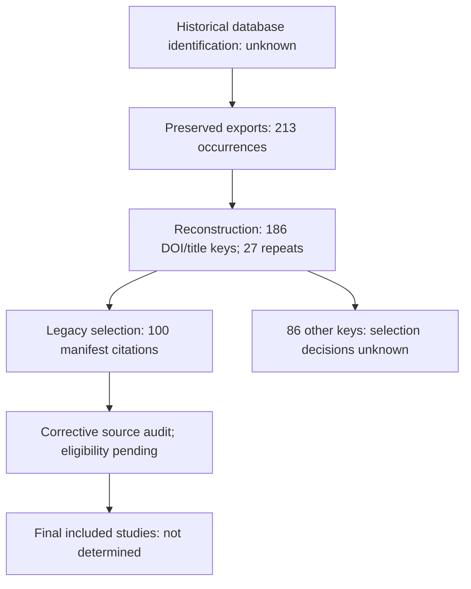
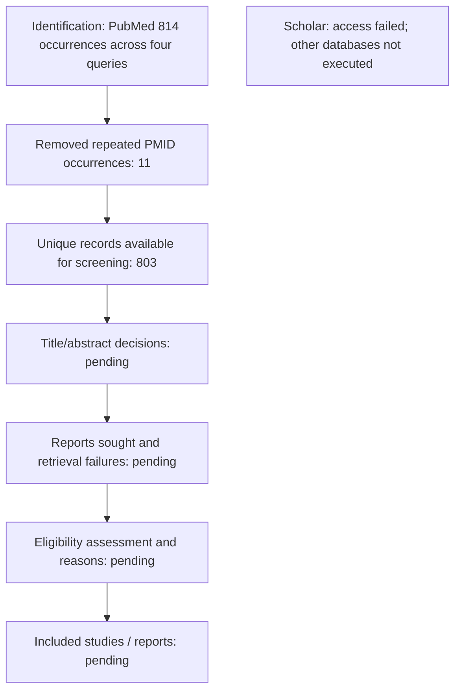

# PRISMA selection record: working draft

Date: 23 October 2026. **Selection is incomplete.** Counts below distinguish the historical collection from the new search. Unknown means not recoverable from the evidence inspected; it never means zero.

The professor's four phases map to identification, screening, eligibility and inclusion. [PRISMA 2020](https://www.prisma-statement.org/prisma-2020-flow-diagram) places retrieval and full-text eligibility within its screening section and distinguishes records, reports and studies. We retain the four teaching labels while tracking the detailed boxes.

## Historical collection: what can be reconstructed

| Item | Count | Evidence / interpretation |
|---|---:|---|
| Original database search results, by database | Unknown | No query/date/yield logs located |
| Archived AgenticAi export occurrences | 117 | Parsed CSV data rows |
| Archived CrossDomain export occurrences | 96 | Parsed CSV data rows |
| Combined archived occurrences | 213 | Export inventory only |
| Distinct exact DOI/title keys within those exports | 186 | `archive_lineage.csv` |
| Repeat occurrences removed by this reconstruction | 27 | 213 minus 186; not necessarily the historical reviewers' deduplication count |
| Current selected manifest records linked to exports | 100 | DOI/title linkage; not completed eligibility confirmation |
| Other distinct export keys | 86 | Selection rationale absent; not documented exclusions |
| Original title/abstract records screened or excluded | Unknown | No decision log located |
| Original full-text reports sought, unavailable, assessed or excluded | Unknown | A present-day PDF inventory cannot establish these historical events |
| Final eligible studies after corrective review | Not determined | Reports have not been grouped by study and adjudicated |

This reconstruction diagram is an audit aid, not a completed PRISMA flow diagram. The arrows do not establish that the original selection team followed these procedures.

## Prospective correction search: executed counts

| PRISMA item | Count / status |
|---|---|
| PubMed P1 occurrences | 216 |
| PubMed P2 occurrences | 151 |
| PubMed P3 occurrences | 435 |
| PubMed P4 occurrences | 12 |
| Combined search occurrences | 814 |
| Repeat PMID occurrences across queries | 11 |
| Unique PubMed records available for screening | 803 |
| Records completed through title/abstract screening | Not yet determined |
| Records excluded after completed screening | Not yet determined |
| Reports sought / not retrieved / assessed for eligibility | Not yet determined |
| Full-text exclusions by reason | Not yet determined |
| Studies and reports included | Not yet determined |

A publication-date filter restricts the searches through 2026-10-23; export responses preserve query translation and IDs. These searches may overlap the legacy collection and each other. The 11 repeats concern cross-query PMIDs only; they are not the final duplicate count after merging all sources.

## Source access audit is a different count

For the 100 legacy citations, 100 files exist, but 38 are generated summaries, three are wrong documents and one is supplementary material only. There are 58 candidate matching main-text PDFs. Original XML provides a replacement main article for the supplement-only record, giving 59 source-covered citations and a 41-record retrieval queue. These counts describe source access today. They do not populate the historical boxes for reports sought, reports assessed or included studies.

## To finalize the flow

Use `new_pubmed_candidates.csv` for record decisions and retain one reason per final exclusion. Reconcile DOI/PMID overlap with the old corpus, assign study-family IDs, and track retrieval separately from eligibility. Keep a dated log of scope changes. Replace pending boxes only from those records, then check that record/report arithmetic reconciles. Additional databases, citation searches and Scholar retrievals belong in their actual source branches once executed.
